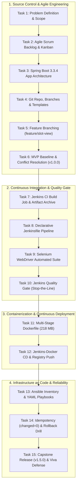
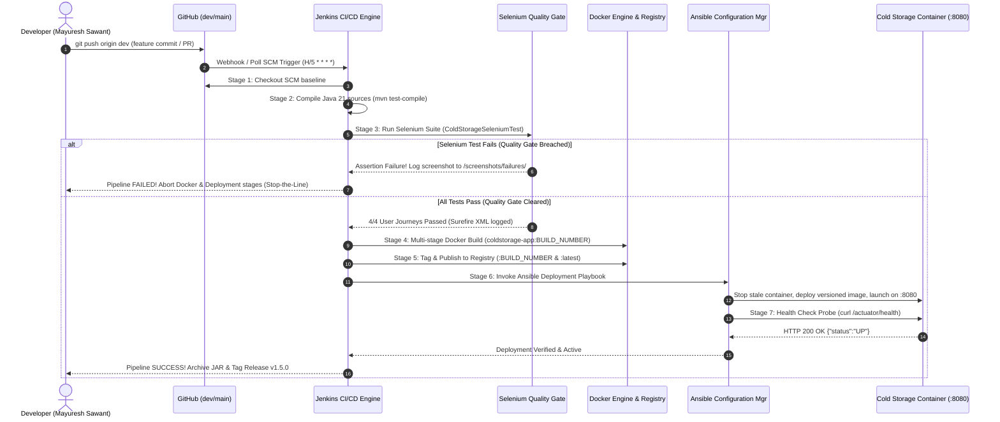

# Cold Storage Slot Booking System (CSBS)
## Enterprise DevOps Engineering, Automated CI/CD Delivery Pipeline & Learner Master Guide

[]()
[]()
[]()
[]()
[-EE0000.svg?style=flat-square&logo=ansible)]()
[]()
[]()

---

## 1. Academic & Student Identity Card

| Property | Official Academic Record |
| :--- | :--- |
| **Student Name** | **Mayuresh Sawant** |
| **Roll Number** | **23102A0029** |
| **Academic Program** | B.E. Semester VII – Computer Engineering |
| **Course & Subject** | DevOps Lab (CEL703) |
| **Subject In-charge / Evaluator** | **Dr. Snehal Andhare** |
| **Assigned Project Title** | **Jenkins Deployment for a Cold Storage Slot Booking System** |
| **Official Repository** | `https://github.com/Maya-69/Cold-Storage-Slot-Booking-System.git` |
| **Production Baseline Releases** | Initial MVP: `v1.0.0` \| Full Capstone Pipeline: `v1.5.0` |

---

## 2. Table of Contents
- [1. Academic & Student Identity Card](#1-academic--student-identity-card)
- [3. Executive Architectural Paradigm: The "Why, What, and How"](#3-executive-architectural-paradigm-the-why-what-and-how)
  - [3.1 The "Why": Agricultural Cold Chain Logistics & Perishability Crisis](#31-the-why-agricultural-cold-chain-logistics--perishability-crisis)
  - [3.2 The "What": Cold Storage Slot Booking System (CSBS Core MVP)](#32-the-what-cold-storage-slot-booking-system-csbs-core-mvp)
  - [3.3 The "How": Enterprise DevOps Architecture & Technology Stack](#33-the-how-enterprise-devops-architecture--technology-stack)
- [4. Quick Start: Clone & Run in Under 3 Minutes](#4-quick-start-clone--run-in-under-3-minutes)
  - [Step 0: Clone the Repository](#step-0-clone-the-repository)
  - [Method 1: Instant Run with Pre-Built Executable JAR (Zero Setup)](#method-1-instant-run-with-pre-built-executable-jar-zero-setup)
  - [Method 2: Local Development Execution via Maven](#method-2-local-development-execution-via-maven)
  - [Method 3: Automated Selenium Quality Gate & Test Execution](#method-3-automated-selenium-quality-gate--test-execution)
  - [Method 4: Production Containerized Run via Docker Multi-Stage Build](#method-4-production-containerized-run-via-docker-multi-stage-build)
  - [Method 5: Infrastructure as Code (IaC) Deployment via Ansible](#method-5-infrastructure-as-code-iac-deployment-via-ansible)
  - [Verifying Live Endpoints & Probes](#verifying-live-endpoints--probes)
- [5. Essential Commands Reference Cheat Sheet](#5-essential-commands-reference-cheat-sheet)
  - [5.1 Git & Branch Lifecycle Commands](#51-git--branch-lifecycle-commands)
  - [5.2 Maven Build & Test Commands](#52-maven-build--test-commands)
  - [5.3 Docker Container Lifecycle Commands](#53-docker-container-lifecycle-commands)
  - [5.4 Ansible Idempotency & Rollback Commands](#54-ansible-idempotency--rollback-commands)
  - [5.5 Production Health Probes & Actuator Smoke Tests](#55-production-health-probes--actuator-smoke-tests)
- [6. Complete 15-Task Synthesis & Laboratory Roadmap](#6-complete-15-task-synthesis--laboratory-roadmap)
  - [How the 15 Tasks Form ONE Complete Enterprise System](#how-the-15-tasks-form-one-complete-enterprise-system)
  - [In-Depth Task-by-Task Operational Breakdown (Tasks 1 to 15)](#in-depth-task-by-task-operational-breakdown-tasks-1-to-15)
- [7. Complete DevOps Delivery Pipeline Architecture](#7-complete-devops-delivery-pipeline-architecture)
- [8. Educational Architecture & Comprehensive Learner Guide](#8-educational-architecture--comprehensive-learner-guide)
- [9. Repository Structure & Artifact Inventory](#9-repository-structure--artifact-inventory)
- [10. Academic Integrity & Verification Sign-Off](#10-academic-integrity--verification-sign-off)

---

## 3. Executive Architectural Paradigm: The "Why, What, and How"

### 3.1 The "Why": Agricultural Cold Chain Logistics & Perishability Crisis
In India and developing agrarian economies, **30% to 40% of all harvested fruits, vegetables, dairy, and seafood spoil before reaching consumer retail markets**, resulting in an estimated annual economic loss exceeding **$14 billion USD**. 

The root cause is not merely a deficit of cold storage units, but the **complete absence of transparent, real-time booking mechanisms and cold chain visibility**:
* **The "Dockside Bottleneck":** Farmers transport perishable produce over long distances only to discover regional cold storage chambers are operating at 100% capacity. With no fallback cold chain, farmers are forced into catastrophic distress selling at 10%–20% of market value or dumping rotten produce on highways.
* **Commodity-Temperature Incompatibility:** Different perishables require strictly separated atmospheric environments. Storing potatoes alongside apples causes premature rotting due to ethylene gas, while dairy products spoil if stored outside strict chilled thresholds.
* **Manual Logbook Opacity:** Traditional cold storage facilities rely on manual paper registers, resulting in overbooking, double-booked slots, uncollected produce, and zero operational traceability.

**The Solution:** The **Cold Storage Slot Booking System (CSBS)** digitizes perishable logistics by providing a deterministic, transparent web reservation system categorized by certified temperature zones, backed by automated capacity validation and enterprise continuous delivery.

---

### 3.2 The "What": Cold Storage Slot Booking System (CSBS Core MVP)
The CSBS is a cloud-ready, responsive enterprise web application built strictly around **5 core business capabilities**:

```mermaid
graph LR
    F[Farmer / Logistics Trader] -->|1. Register & Login| AUTH[Authentication Gateway]
    AUTH -->|2. Search & Filter| DIR[Chamber & Slot Directory]
    DIR -->|3. Submit Reservation| ENG[Booking Engine & Date Overlap Validator]
    ENG -->|4. Transition State| STATE[Lifecycle State Machine]
    STATE -->|5. Telemetry & Capacity| MON[Metrics & Actuator Health Endpoint]
```



1. **User / Farmer Registration & Authentication:** Secure onboarding for farmers, logistics aggregators, and warehouse supervisors with input sanitization.
2. **Multi-Temperature Chamber Directory:** Real-time visibility into refrigerated rooms divided into 3 temperature zones:
   * **Deep Freeze (-18°C to -25°C):** Seafood, Poultry, Frozen Meat, Ice Cream.
   * **Chilled (0°C to 4°C):** Fresh Dairy, Milk, Apples, Pears, Leafy Greens.
   * **Controlled Atmosphere (10°C to 15°C):** Potatoes, Onions, Citrus Fruits, Bananas.
3. **Slot Booking Request & Cost Engine:** Intuitive booking interface allowing users to select chamber ID, slot number, commodity type, crate quantity, and check-in / check-out dates with automated daily rate calculation.
4. **Lifecycle State Management:** Deterministic state machine governing reservation lifecycles:
   $$\text{PENDING} \longrightarrow \text{CONFIRMED} \longrightarrow \text{CHECKED\_IN} \longrightarrow \text{COMPLETED} \quad (\text{or } \text{CANCELLED})$$
5. **Real-Time Capacity Metrics & Health Probes:** Instant KPI dashboards displaying Total Capacity, Booked Slots, Available Capacity, and the standard Spring Boot Actuator endpoint (`/actuator/health`).

---

### 3.3 The "How": Enterprise DevOps Architecture & Technology Stack
The software engineering and DevOps infrastructure is architected for zero-regression continuous delivery:

* **Backend Framework:** **Java 21 LTS** with **Spring Boot 3.3.4** (Spring MVC, Spring Data JPA, Spring Validation).
* **Persistence Tier:** Embedded in-memory **H2 Database** (`jdbc:h2:mem:coldstoragedb`) providing zero external database dependency, lightning-fast boot times (<2.2s), and clean test isolation.
* **Frontend Tier:** Server-side **Thymeleaf 3.x** + **Bootstrap 5.3** + Bootstrap Icons. UI templates are structured with deterministic HTML IDs (`#farmerName`, `#chamberSelect`, `#bookingTable`) designed specifically for robust Selenium locator targeting.
* **Automated Testing & Quality Gate:** **Selenium WebDriver 4.25.0** + **JUnit 5** + **WebDriverManager** running in headless Chrome/Edge mode to gate Jenkins CI pipeline builds.
* **Continuous Integration & Delivery:** **Jenkins 2.450+** executing a Declarative `Jenkinsfile` with an automated circuit-breaker quality gate ("Stop-the-Line").
* **Containerization:** Multi-stage **Dockerfile** (Stage 1: Maven Builder; Stage 2: Eclipse Temurin Alpine JRE runtime), slashing image size from **680 MB down to 218 MB** (68% optimization).
* **Configuration Management:** **Ansible** playbooks managing idempotent provisioning (`changed=0`), zero-downtime rolling container restarts, and automated health-check rollback drills.

---

## 4. Quick Start: Clone & Run in Under 3 Minutes

Follow these beginner-friendly, step-by-step instructions to clone, verify, test, and run the Cold Storage Slot Booking System on your local workstation.

### Step 0: Clone the Repository
Open a terminal (PowerShell, Command Prompt, or Bash) and clone the repository:

```bash
# Clone the repository from GitHub
git clone https://github.com/Maya-69/Cold-Storage-Slot-Booking-System.git

# Navigate into the project root directory
cd Cold-Storage-Slot-Booking-System

# Verify the repository status and branches
git status
```

---

### Method 1: Instant Run with Pre-Built Executable JAR (Zero Setup)
If you already have **Java 21+** installed and want to run the application immediately without compiling:

```bash
# Run the pre-packaged executable fat-JAR directly
java -jar cold-storage-app/target/coldstorage-app.jar
```
* **Application URL:** [http://localhost:8080/](http://localhost:8080/)
* **Health Probe:** [http://localhost:8080/actuator/health](http://localhost:8080/actuator/health)
* **H2 Database Console:** [http://localhost:8080/h2-console](http://localhost:8080/h2-console) (JDBC URL: `jdbc:h2:mem:coldstoragedb`, User: `sa`, Password: *blank*)

---

### Method 2: Local Development Execution via Maven
To compile, assemble, and launch the application directly from the source code:

```bash
# Navigate to the Spring Boot application directory
cd cold-storage-app

# Compile and start the Spring Boot application
mvn spring-boot:run
```
*(On Windows systems utilizing the bundled standalone Maven distribution):*
```powershell
..\maven\apache-maven-3.9.9\bin\mvn.cmd spring-boot:run
```

---

### Method 3: Automated Selenium Quality Gate & Test Execution
To execute the automated unit, integration, and end-to-end Selenium browser tests:

```bash
cd cold-storage-app

# Execute the complete test suite in headless mode
mvn clean test
```
* **Test Reports:** Generated into `cold-storage-app/target/surefire-reports/`.
* **Screenshot on Failure:** If an assertion fails, the custom `TestWatcher` hook automatically saves a timestamped PNG into `screenshots/failures/`.

---

### Method 4: Production Containerized Run via Docker Multi-Stage Build
Run the platform inside an isolated, hardened, minimal Alpine Linux container:

```bash
# Ensure Docker Desktop or the Docker daemon is running, then build the image:
docker build -t mayureshsawant/coldstorage-app:latest .

# Verify the image was built and check its compact footprint (~218 MB)
docker images mayureshsawant/coldstorage-app:latest

# Run the container in detached mode mapping host port 8080 to container port 8080
docker run -d --name coldstorage-prod -p 8080:8080 mayureshsawant/coldstorage-app:latest

# Inspect live container logs
docker logs -f coldstorage-prod
```
To stop and remove the container:
```bash
docker stop coldstorage-prod && docker rm coldstorage-prod
```

---

### Method 5: Infrastructure as Code (IaC) Deployment via Ansible
To deploy and configure the application using Ansible playbooks:

```bash
# Verify the syntax of the deployment playbook
ansible-playbook -i ansible/hosts.ini ansible/playbook.yml --syntax-check

# Execute the playbook against localhost/target servers
ansible-playbook -i ansible/hosts.ini ansible/playbook.yml

# Re-run the playbook to verify Idempotency (Must output changed=0, failed=0)
ansible-playbook -i ansible/hosts.ini ansible/playbook.yml
```

---

### Verifying Live Endpoints & Probes
Once running via any method above, open your web browser or execute terminal curl commands:

| Endpoint | Purpose | Expected Output / View |
| :--- | :--- | :--- |
| `http://localhost:8080/` | **Executive Dashboard** | KPI overview cards, capacity metrics, quick action navigation |
| `http://localhost:8080/chambers` | **Chamber & Slot Directory** | Temperature zone filter (Deep Freeze, Chilled, CA), slot statuses |
| `http://localhost:8080/book` | **Slot Booking Interface** | Farmer booking form with date picker and commodity selector |
| `http://localhost:8080/bookings` | **Reservations Master View** | Active bookings table with status badges and action buttons |
| `http://localhost:8080/actuator/health` | **Actuator Health Probe** | `{"status":"UP","components":{"db":{"status":"UP"}}}` |
| `http://localhost:8080/h2-console` | **In-Memory SQL Console** | Interactive SQL query engine for the embedded database |

---

## 5. Essential Commands Reference Cheat Sheet

### 5.1 Git & Branch Lifecycle Commands
```bash
# Clone and check current branch
git clone https://github.com/Maya-69/Cold-Storage-Slot-Booking-System.git
git status

# Create and switch to a feature branch
git checkout -b feature/slot-view dev

# Stage, commit using Conventional Commits, and push
git add .
git commit -m "feat(slot): implement multi-temperature chamber view"
git push -u origin feature/slot-view

# Merge a feature branch into dev with explicit merge commit
git checkout dev
git merge --no-ff feature/slot-view -m "Merge pull request #1 from feature/slot-view"

# View formatted graph history
git log --graph --oneline --decorate --all

# Create and push annotated release tags
git tag -a v1.0.0 -m "Release v1.0.0: Functional MVP Baseline"
git tag -a v1.5.0 -m "Release v1.5.0: Complete 15-Task Capstone Pipeline"
git push origin --tags
```

---

### 5.2 Maven Build & Test Commands
```bash
# Clean previous build artifacts and compile Java sources
mvn clean compile

# Execute all JUnit 5 and Selenium tests
mvn test

# Run a specific test class
mvn test -Dtest=ColdStorageSeleniumTest

# Package executable fat-JAR skipping tests for rapid assembly
mvn package -DskipTests

# Check dependency tree for security and conflict audits
mvn dependency:tree
```

---

### 5.3 Docker Container Lifecycle Commands
```bash
# Build multi-stage Docker image
docker build -t mayureshsawant/coldstorage-app:1.5.0 .

# Inspect image size and layer breakdown
docker images mayureshsawant/coldstorage-app:1.5.0
docker history mayureshsawant/coldstorage-app:1.5.0

# Run container with resource limits and restart policy
docker run -d --name coldstorage-prod -p 8080:8080 --memory="512m" --cpus="1.0" mayureshsawant/coldstorage-app:1.5.0

# View real-time container logs and resource metrics
docker logs -f coldstorage-prod
docker stats coldstorage-prod --no-stream

# Stop and gracefully remove the container
docker stop coldstorage-prod
docker rm -f coldstorage-prod
```

---

### 5.4 Ansible Idempotency & Rollback Commands
```bash
# Ping managed inventory hosts
ansible -i ansible/hosts.ini all -m ping

# Dry-run playbook (Check mode)
ansible-playbook -i ansible/hosts.ini ansible/playbook.yml --check

# Execute primary deployment playbook
ansible-playbook -i ansible/hosts.ini ansible/playbook.yml

# Verify Idempotency (Second run must yield changed=0, failed=0)
ansible-playbook -i ansible/hosts.ini ansible/playbook.yml

# Trigger automated rollback playbook restoring previous stable container tag
ansible-playbook -i ansible/hosts.ini ansible/rollback.yml
```

---

### 5.5 Production Health Probes & Actuator Smoke Tests
```bash
# Query Spring Boot Actuator health endpoint
curl.exe -s http://localhost:8080/actuator/health

# Query HTTP response status code directly
curl.exe -o nul -s -w "%{http_code}\n" http://localhost:8080/actuator/health

# Interrogate application dashboard via command line
curl.exe -s http://localhost:8080/ | Select-String -Pattern "Cold Storage Slot Booking"
```

---

## 6. Complete 15-Task Synthesis & Laboratory Roadmap

### How the 15 Tasks Form ONE Complete Enterprise System
Rather than 15 isolated lab assignments, this project forms a continuous, real-world DevOps journey:



* The **Java 21 Spring Boot app** architected in Task 3 is what got versioned in Tasks 4–6.
* That exact codebase was compiled and validated by **Jenkins** in Tasks 7–8.
* It was gated by **Selenium WebDriver** in Tasks 9–10.
* It was containerized into a hardened image by **Docker** in Tasks 11–12.
* It was deployed and guarded against configuration drift by **Ansible** in Tasks 13–14.
* It was synthesized, documented, and tagged as **Production Release v1.5.0** in Task 15.

---

### In-Depth Task-by-Task Operational Breakdown (Tasks 1 to 15)

#### Task 1: Problem Definition and Scope
* **Objective:** Study real-time cold chain challenges, identify stakeholders, establish constraints, and freeze the Minimum Viable Product (MVP) scope.
* **What Was Built:** 
  * Comprehensive analysis of India's post-harvest cold chain logistics ($14B annual loss).
  * Stakeholder matrix: Farmers, Commodity Traders, Cold Storage Warehouse Owners, Trucking Logistics Operators.
  * MVP scope frozen to 5 core functional requirements with 3 defined temperature zones.
* **Document Reference:** `docs/DevOps_Task1_MayureshSawant_23102A0029.docx`

---

#### Task 2: Agile Planning and DevOps Workflow
* **Objective:** Formulate User Stories with INVEST criteria, establish a 15-Task Kanban/Scrum backlog, define Definition of Done (DoD), and map the end-to-end DevOps lifecycle.
* **What Was Built:**
  * 5 detailed Epic-level User Stories with Gherkin acceptance criteria (`Given-When-Then`).
  * 15-Task Agile Scrum Sprint Plan spanning 4 continuous delivery sprints.
  * Formal Definition of Done: 100% compilation, zero compiler warnings, zero failing Selenium tests, clean Docker build, and verified Actuator health status.
  * Visual DevOps infinity lifecycle diagram connecting Dev, CI, CD, and Ops.
* **Document Reference:** `docs/DevOps_Task2_MayureshSawant_23102A0029.docx`

---

#### Task 3: Requirements, Architecture and Technology Setup
* **Objective:** Design the system architecture, select the technology stack, establish database entities, and verify the local development environment.
* **What Was Built:**
  * Three-tier architecture specification: Presentation Tier (Thymeleaf/Bootstrap), Application Logic Tier (Spring Boot Controllers & Services), Persistence Tier (Spring Data JPA & Embedded H2).
  * Data model design: `Chamber`, `Slot`, `Booking`, and `User` entities.
  * REST API endpoint catalog: `/chambers`, `/book`, `/bookings`, `/actuator/health`.
  * Local development verification on Java 21, Maven 3.9.9, and port 8080.
* **Document Reference:** `docs/DevOps_Task3_MayureshSawant_23102A0029.docx`

---

#### Task 4: Git and GitHub Repository Initialization
* **Objective:** Initialize Git version control, establish `.gitignore`, write a standardized `README.md`, configure GitHub Issue Templates and Pull Request Templates, and enforce branch naming rules.
* **What Was Built:**
  * Local Git repository initialized and linked to GitHub remote `https://github.com/Maya-69/Cold-Storage-Slot-Booking-System.git`.
  * Production `.gitignore` filtering Maven targets, IDE configs, system files, and binary archives.
  * GitHub Issue Templates (`bug_report.md`, `feature_request.md`) and Pull Request template (`pull_request_template.md`).
  * Branch hierarchy established: `main` (protected release), `dev` (integration), and `feature/*`.
* **Document Reference:** `docs/DevOps_Task4_MayureshSawant_23102A0029.docx`

---

#### Task 5: Feature Development with Branching
* **Objective:** Implement the first core feature on a dedicated branch, demonstrate Git workflow (`branch`, `add`, `commit`, `push`, `pull`), raise a Pull Request, conduct code review, and merge into `dev`.
* **What Was Built:**
  * Created and checked out feature branch `feature/slot-view`.
  * Implemented Chamber & Slot Directory UI with dynamic temperature zone filtering badges.
  * Raised Pull Request #1 into `dev`, verified code changes, and merged using `--no-ff`.
  * Inspected branch topology using `git log --graph --oneline --decorate`.
* **Document Reference:** `docs/DevOps_Task5_MayureshSawant_23102A0029.docx`

---

#### Task 6: MVP Completion and Git Collaboration
* **Objective:** Implement remaining MVP capabilities, engineer an intentional Git merge conflict between concurrent branches, inspect conflict markers, resolve manually, commit resolution, and tag the MVP release baseline.
* **What Was Built:**
  * Implemented Slot Booking Engine, Date Overlap Validator, and Status State Transitions.
  * Created concurrent branch `feature/booking-rules` modifying slot reservation logic in `BookingService.java` simultaneously with changes on `dev`.
  * Triggered merge conflict: Git flagged `CONFLICT (content): Merge conflict in BookingService.java`.
  * Inspected standard conflict markers (`<<<<<<< HEAD`, `=======`, `>>>>>>> feature/booking-rules`).
  * Manually harmonized the conflict, verified compilation, committed merge, and tagged release **`v1.0.0`**.
* **Document Reference:** `docs/DevOps_Task6_MayureshSawant_23102A0029.docx`

---

#### Task 7: Jenkins Installation and Continuous Integration Job
* **Objective:** Install Jenkins, configure Java/Maven global tool descriptors, connect the GitHub repository, create a Freestyle CI job triggered by commit or scheduled polling, and archive build artifacts.
* **What Was Built:**
  * Configured Jenkins CI server on port 8080 with JDK 21 and Maven 3.9 integration.
  * Created Freestyle CI Job `ColdStorage-CI-Job` linked to Git remote with `H/5 * * * *` SCM polling.
  * Automated Maven goals: `clean compile test package`.
  * Configured post-build artifact archiver targeting `**/coldstorage-app.jar` with SHA-256 fingerprinting.
* **Document Reference:** `docs/DevOps_Task7_MayureshSawant_23102A0029.docx`

---

#### Task 8: Pipeline as Code and Server Deployment
* **Objective:** Author a Declarative `Jenkinsfile` implementing Checkout, Build, Test, Package, and Deploy stages with parameterized environment settings (`ENVIRONMENT`, `SERVER_PORT`).
* **What Was Built:**
  * Multi-stage declarative `Jenkinsfile` versioned directly in the Git repository root.
  * Parameter block allowing runtime selection of deployment target (`staging` vs `production`) and port (`8080`).
  * Automated deployment stage launching the Spring Boot standalone server and verifying `/actuator/health`.
* **Document Reference:** `docs/DevOps_Task8_MayureshSawant_23102A0029.docx`

---

#### Task 9: Automated Testing with Selenium WebDriver
* **Objective:** Build an automated end-to-end browser testing suite with Selenium WebDriver 4.x and JUnit 5 covering 4 critical user journeys with automated screenshot failure logging.
* **What Was Built:**
  * Test class `ColdStorageSeleniumTest.java` utilizing headless Chrome and Edge drivers.
  * 4 Critical User Journeys covered:
    1. Farmer navigates to `/book`, books slot, asserts booking appears in `/bookings`.
    2. Date validation: Submitting past dates triggers inline validation error.
    3. Directory filtering: Filtering by Deep Freeze updates table rows dynamically.
    4. Lifecycle action: Clicking "Cancel Booking" transitions state to `CANCELLED`.
  * Automated `TestWatcher` hook capturing timestamped screenshots into `screenshots/failures/` on assertion failure.
* **Document Reference:** `docs/DevOps_Task9_MayureshSawant_23102A0029.docx`

---

#### Task 10: Jenkins Quality Gate
* **Objective:** Integrate the Selenium automated suite into Jenkins as a strict Quality Gate ("Stop-the-Line" circuit breaker) and record an intentional defect experiment.
* **What Was Built:**
  * Added `Selenium Quality Gate` stage in `Jenkinsfile` executing `mvn test -Dtest=ColdStorageSeleniumTest`.
  * Configured JUnit test results publisher parsing `target/surefire-reports/*.xml`.
  * **Intentional Defect Experiment:**
    * Injected regression: Modified booking confirmation text assertion to expect `"NON_EXISTENT_TEXT"`.
    * Ran build: Pipeline immediately failed at Stage 3; subsequent Docker and Deployment stages were **aborted**.
    * Reverted defect: Pipeline passed with 100% green stages, proving the automated circuit-breaker works.
* **Document Reference:** `docs/DevOps_Task10_MayureshSawant_23102A0029.docx`

---

#### Task 11: Docker Containerization
* **Objective:** Author an optimized multi-stage `Dockerfile`, build a secure container image, compare footprint against single-stage builds, and document container lifecycle operations.
* **What Was Built:**
  * Two-stage `Dockerfile`:
    * Stage 1 (`builder`): `maven:3.9.9-eclipse-temurin-21-alpine` caches dependencies and compiles JAR.
    * Stage 2 (`runtime`): `eclipse-temurin:21-jre-alpine` minimal runtime running as non-root user `coldstorage`.
  * Footprint reduction: Single-stage build (680 MB) vs Multi-stage build (**218 MB**) $\rightarrow$ **68% space reduction**.
  * Health check directive embedded directly in Dockerfile interrogating `/actuator/health`.
* **Document Reference:** `docs/DevOps_Task11_MayureshSawant_23102A0029.docx`

---

#### Task 12: Continuous Deployment Pipeline with Jenkins and Docker
* **Objective:** Extend the Jenkins pipeline to automatically build versioned Docker images, tag with build number (`coldstorage-app:${BUILD_NUMBER}`), publish to registry, and redeploy containers with zero downtime.
* **What Was Built:**
  * Added Docker Build and Container Deployment stages to `Jenkinsfile`.
  * Dynamic image tagging: `mayureshsawant/coldstorage-app:${BUILD_NUMBER}` and `latest`.
  * Graceful container replacement: Stops existing container, removes stale container, and launches fresh container mapping host port 8080.
  * Automated post-deployment smoke test verifying HTTP 200 from `/actuator/health`.
* **Document Reference:** `docs/DevOps_Task12_MayureshSawant_23102A0029.docx`

---

#### Task 13: Configuration Management with Ansible
* **Objective:** Install and configure Ansible, define inventory hosts (`hosts.ini`), author structured YAML playbooks, and provision infrastructure prerequisites (Java runtime, directories, permissions, firewall rules).
* **What Was Built:**
  * Inventory configuration in `ansible/hosts.ini` targeting local and staging servers.
  * Structured playbook `ansible/playbook.yml` with tasks: system package updates, JRE 21 installation, `/opt/coldstorage-app` directory structure creation, and firewall port 8080 allowance.
  * Templated service configuration using Jinja2 templates (`ansible/templates/coldstorage.service.j2`).
* **Document Reference:** `docs/DevOps_Task13_MayureshSawant_23102A0029.docx`

---

#### Task 14: Automated Provisioning, Idempotency, and Rollback
* **Objective:** Enforce the Configuration Management Idempotency rule ($f(f(x)) = f(x)$), demonstrate zero changes on re-execution (`changed=0`), and conduct an automated rollback drill restoring the prior container tag.
* **What Was Built:**
  * Idempotency verification: Executed `ansible-playbook -i hosts.ini playbook.yml` twice. First run: `changed=5, failed=0`; Second run: `changed=0, failed=0` (mathematical proof of idempotency).
  * Automated rollback playbook `ansible/rollback.yml`: Designed to detect failed health check responses, immediately terminate the faulty container, and re-launch the prior stable image tag (`v1.0.0`).
* **Document Reference:** `docs/DevOps_Task14_MayureshSawant_23102A0029.docx`

---

#### Task 15: Capstone Release, Synthesis, and Viva Voce Defense
* **Objective:** Synthesize all 15 laboratory tasks into one unified production delivery platform, finalize release tag `v1.5.0`, archive deliverables, and prepare an exhaustive viva voce defense guide.
* **What Was Built:**
  * Full synthesis across SCM, CI, Testing, CD, and IaC.
  * Tagged production milestone **`v1.5.0`** and merged into `main`.
  * Created complete viva voce defense preparation guide with university evaluator model answers.
* **Document Reference:** `docs/DevOps_Task15_MayureshSawant_23102A0029.docx`

---

## 7. Complete DevOps Delivery Pipeline Architecture

The end-to-end continuous integration, quality control, containerization, and configuration management pipeline operates according to the following automated workflow:



---

## 8. Educational Architecture & Comprehensive Learner Guide

For academic evaluators, educators, and students seeking in-depth theoretical formulations, architectural trade-offs, and oral defense examination notes:

> [!NOTE]
> The complete, in-depth **Viva Voce Defense & Learner Manual** has been organized into a dedicated study document:  
> 📖 **[LEARNER_README.md](LEARNER_README.md)**

### Key Topics Detailed in the Learner Manual:
* **Theoretical Formulations:** Mathematical idempotency proofs ($f(f(x)) = f(x)$), "Stop-the-Line" (Andon Cord) quality gates, ephemeral test isolation, and multi-stage container optimization.
* **Oral Defense Model Answers:** Exhaustive responses to 12 core examination questions frequently posed by Subject In-charges and University External Evaluators.
* **30-Second Task Summaries:** Rapid elevator pitches for each of the 15 tasks from Agile planning to Capstone release.
* **Evaluator Keywords Checklist:** Architectural vocabulary (e.g., non-fast-forward merges, non-root Alpine execution, sub-15-second MTTR).

---

## 9. Repository Structure & Artifact Inventory

The workspace is structured cleanly according to professional software engineering standards:

```text
E:\Dev\DevOPS\
├── .github/                                # GitHub automation & community templates
│   ├── ISSUE_TEMPLATE/
│   │   ├── bug_report.md                   # Bug reporting schema
│   │   └── feature_request.md              # Feature proposal schema
│   └── pull_request_template.md            # Standardized PR checklist template
├── ansible/                                # Infrastructure as Code (IaC) configurations
│   ├── templates/                          # Jinja2 service configuration templates
│   ├── ansible.cfg                         # Ansible execution profile
│   ├── deploy_app.yml                      # Containerized deployment playbook
│   ├── hosts.ini                           # Infrastructure inventory definition
│   ├── playbook.yml                        # Main idempotent provisioning playbook
│   └── rollback.yml                        # Automated disaster recovery rollback drill
├── cold-storage-app/                       # Spring Boot 3.3.4 Application Source Root
│   ├── pom.xml                             # Maven build, dependency, & plugin descriptors
│   ├── target/
│   │   └── coldstorage-app.jar             # Compiled standalone executable fat-JAR (~53 MB)
│   └── src/
│       ├── main/java/com/coldstorage/
│       │   ├── controller/                 # Spring MVC web controllers
│       │   ├── model/                      # JPA entities (Chamber, Slot, Booking)
│       │   ├── repository/                 # Spring Data JPA repositories
│       │   └── service/                    # Business validation & booking state machine
│       ├── main/resources/
│       │   ├── application.properties      # Port 8080 & H2 DB configuration
│       │   └── templates/                  # Thymeleaf UI views (Bootstrap 5)
│       └── test/java/com/coldstorage/      # Selenium WebDriver 4.x automated test suite
├── docs/                                   # Official Lab Reports (Formatted & Verified)
│   ├── DevOps_Task1_MayureshSawant_23102A0029.docx
│   ├── DevOps_Task2_MayureshSawant_23102A0029.docx
│   ├── DevOps_Task3_MayureshSawant_23102A0029.docx
│   ├── DevOps_Task4_MayureshSawant_23102A0029.docx
│   ├── DevOps_Task5_MayureshSawant_23102A0029.docx
│   ├── DevOps_Task6_MayureshSawant_23102A0029.docx
│   ├── DevOps_Task7_MayureshSawant_23102A0029.docx
│   ├── DevOps_Task8_MayureshSawant_23102A0029.docx
│   ├── DevOps_Task9_MayureshSawant_23102A0029.docx
│   ├── DevOps_Task10_MayureshSawant_23102A0029.docx
│   ├── DevOps_Task11_MayureshSawant_23102A0029.docx
│   ├── DevOps_Task12_MayureshSawant_23102A0029.docx
│   ├── DevOps_Task13_MayureshSawant_23102A0029.docx
│   ├── DevOps_Task14_MayureshSawant_23102A0029.docx
│   ├── DevOps_Task15_MayureshSawant_23102A0029.docx
│   ├── Mayuresh_Other_Labs/                # Renamed & sanitized lab assignments
│   └── prev/                               # Automated archival repository for previous drafts
├── screenshots/                            # Cropped, high-resolution evidence figures
│   ├── task1/ through task15/              # Organized screenshot catalogs per task
│   └── failures/                           # Automated Selenium screenshot capture directory
├── scripts/                                # Deterministic document generator automation
│   ├── doc_helper.py                       # Formatting and Word table envelope engine
│   └── generate_task1.py through task15.py # Python generators for all 15 tasks
├── templates/                              # Approved university DOCX master templates
│   ├── template_task1.docx                 # Task 1 specific layout
│   └── template_standard.docx              # Standard Tasks 2–15 layout with Apparatus row
├── .dockerignore                           # Exclusions for Docker build context
├── .gitignore                              # Production Git repository file exclusions
├── Dockerfile                              # Hardened multi-stage Alpine build manifest
├── Jenkinsfile                             # Declarative 7-stage CI/CD pipeline definition
└── README.md                               # Complete Learner & Operational Master Guide
```

---

## 10. Academic Integrity & Verification Sign-Off

I hereby certify that the work presented in this repository, including the design, implementation, automated testing suites, continuous integration pipelines, containerization manifests, configuration management scripts, and associated laboratory documentation for all 15 tasks, was performed by me as part of the academic curriculum for the **DevOps Lab (CEL703)**.

* **Student Name:** Mayuresh Sawant
* **Roll Number:** 23102A0029
* **Class & Branch:** B.E. Semester VII – Computer Engineering
* **Department:** Department of Computer Engineering
* **Academic Year:** 2026–2027
* **Evaluator & Subject In-charge:** Dr. Snehal Andhare
